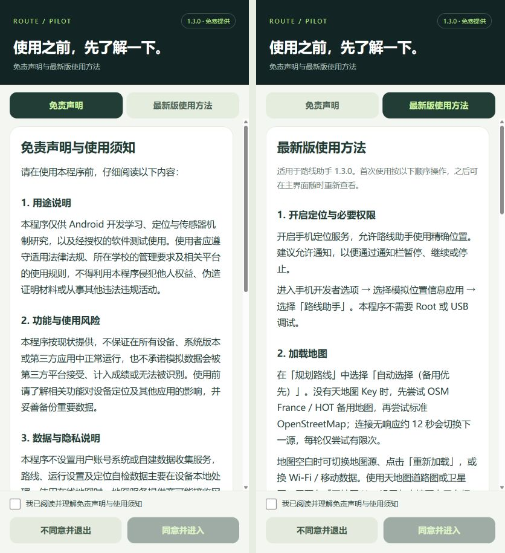

# 路线助手 · RoutePilot

用于 Android 定位机制学习及经授权的软件测试的路线模拟与定位自检应用。最低 Android 8.0（API 26），当前版本 **1.3.0**。

本程序的开发、维护及发布由 B站用户 **后藤一里的发带** 负责，完全免费提供。第三方代码与组件保留原有署名与许可证，详情见 [NOTICE.md](NOTICE.md) 和 [LICENSE](LICENSE)。

## 下载与使用

- [Android 安装包：RoutePilot 1.3.0](downloads/RoutePilot-1.3.0.apk)
- [APK SHA-256 校验值](downloads/SHA256.txt)
- [完整使用方法](docs/使用方法.md)
- [免责声明与使用须知](docs/免责声明与使用须知.txt)
- [版本说明与验证范围](docs/版本说明.md)

安装后，开启手机定位并允许精确位置，在开发者选项中将模拟位置信息应用选择为“路线助手”。首次进入时会展示免责声明与使用方法。日常使用不需要 Root 或 USB 调试。

APK 使用开发签名。源码不包含该签名的私钥；自行构建产生不同密钥时，不能直接覆盖此 APK，需要先导出路线再卸载重装。

## 功能

- 在线地图点击选点、WGS84 坐标输入、GPX 导入导出。
- 单程或闭环循环、固定速度、目标距离停止。
- 前台运行通知与暂停、继续、停止。
- OSM France / HOT、标准 OpenStreetMap 及天地图道路／卫星底图。
- 可选“卫星位置兼容”实验功能，以及 30 秒定位回调与卫星状态自检。
- 内置启动说明，主界面可随时重新查看。



## 功能边界

本程序使用 Android 公开测试定位接口，系统会标记位置为模拟数据。**不提供真实卫星信号增强、步频／步幅注入、手机虚拟安卓或反检测功能，不保证第三方平台接受模拟数据或计入成绩。**

“卫星位置兼容”仅调整位置更新频率和历史附加字段，不会生成真实 GNSS 测量。自检仅反映本应用收到的回调，不能代表其他应用收到或认可的数据。

地图需要联网；天地图需要使用者自行提供有权使用的地图服务 Key。路线和设置保存在本机，Key 不包含在源码中。在线地图服务商会收到显示区域、网络地址等必要请求信息。

已完成 APK 编译、签名、路线计算、地图控制与前端数据契约检查，以及浏览器中的启动页预览。**未进行安卓真机安装与运行验证，也未验证运动世界等第三方平台的接受情况。**

## 从源码构建

### 直接构建（已验证）

需要 Python 3.8+、JDK 21、Android SDK Platform 36 和 Build Tools 36.0.0。

```powershell
python build.py --jdk "C:\path\to\jdk-21" --platform "C:\path\to\Android\Sdk\platforms\android-36\android.jar" --tools "C:\path\to\Android\Sdk\build-tools\36.0.0"
```

可通过 `JAVA_HOME` 指定 JDK 并省略 `--jdk`。构建依次调用 aapt2、javac、D8、zipalign 和 apksigner。APK 输出到项目目录的上一级；中间文件及本机开发密钥默认位于 `build-local/`，可用 `--work-dir` 更改。

脚本使用公开的开发用默认密码生成本机开发密钥，不应将其用于正式发布。不要提交生成的密钥文件。

### Android Studio

可将本目录作为 Gradle 项目打开。配置使用 Android Gradle Plugin 8.10.1、compile / target SDK 36、min SDK 26、Java 8 源码兼容级别。请使用与该插件兼容的 Gradle 和 JDK 环境。

本仓库未附带 Gradle Wrapper；Gradle 构建路径尚未验证，交付 APK 使用上述直接构建方式生成。

## 检查

```powershell
node tests/map-controller.test.cjs
node tests/ui-contract.test.cjs
javac -encoding UTF-8 -d build-tests app/src/main/java/cn/routepilot/app/RouteEngine.java tests/RouteEngineTest.java
java -cp build-tests RouteEngineTest
```

## 开源与地图来源

- 应用源码按 **GNU GPLv3** 提供，完整文本见 [LICENSE](LICENSE)。
- 定位兼容处理参考 [ZCShou / GoGoGo（影梭）](https://github.com/ZCShou/GoGoGo) 1.12.3；本程序为独立应用，不是其官方发行版。
- Leaflet 1.9.4 按 BSD-2-Clause 提供，见 [第三方许可证](app/src/main/assets/LEAFLET-LICENSE.txt)。
- 地图数据 © [OpenStreetMap contributors](https://www.openstreetmap.org/copyright)。标准底图遵循 [OSM 瓦片使用政策](https://operations.osmfoundation.org/policies/tiles/)。
- HOT 风格备用地图由 OSM France 托管，使用需遵守其[服务条件](https://www.openstreetmap.fr/usage/)，包括免费、非营利、适量访问及明确署名等要求。
- 天地图使用需遵守其[地图服务要求](https://lbs.tianditu.gov.cn/server/MapService.html)及对应授权。

请勿利用本程序侵犯他人权益、伪造证明材料或从事其他违法违规活动。使用者应遵守所在学校及相关平台的规则。
